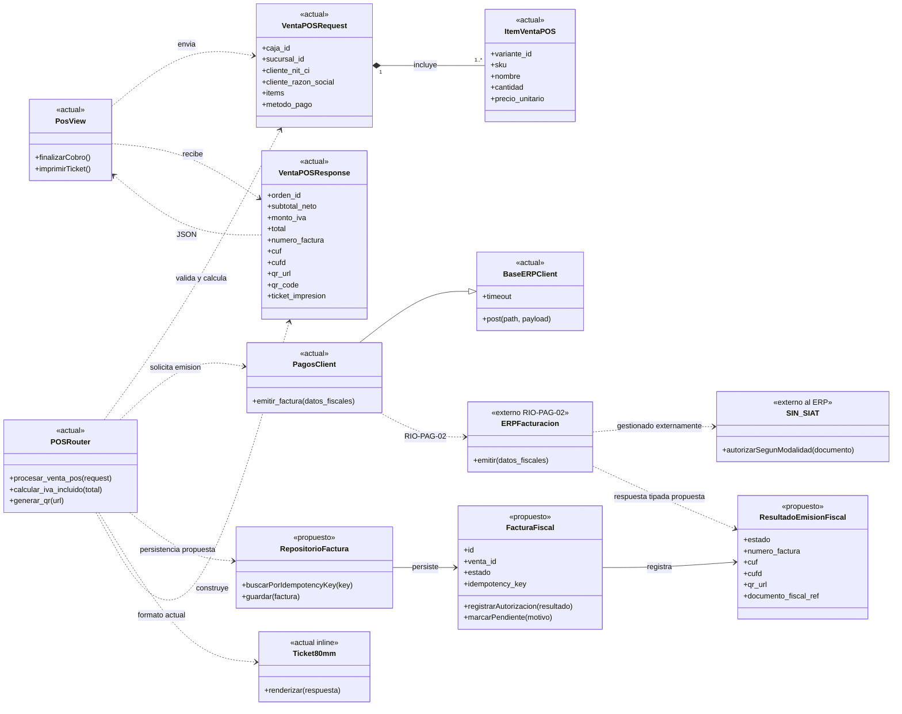
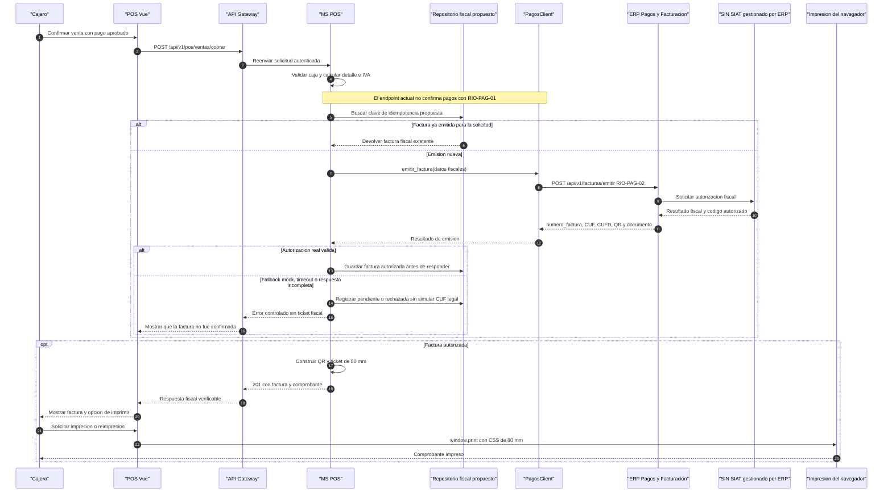

# Diseño de emisión de facturas legales en POS

## Propósito y alcance

Este diseño responde a US-10: emitir y entregar al cliente un comprobante de venta y, cuando la autoridad fiscal lo autorice, su factura electrónica. Describe el flujo del POS actual y el flujo objetivo para completar la integración RIO-PAG-02; no implica que el sistema ya esté conectado al SIN/SIAT ni sustituye la validación del contrato fiscal por el ERP.

La frontera propuesta conserva al **MS POS** como orquestador de la venta de mostrador y a `PagosClient` como adaptador al ERP externo de Pagos y Facturación. La comunicación con el SIN/SIAT, certificados, credenciales y contingencias fiscales pertenecen al ERP/proveedor autorizado, salvo que el contrato real indique otra cosa. No se propone un nuevo microservicio para esta historia.

## Estado actual del sistema

| Paso | Implementación encontrada |
| --- | --- |
| Inicio desde caja | `PosView.vue` envía `POST /api/v1/pos/ventas/cobrar` por el gateway y solicita después la impresión mediante `window.print()` con formato de 80 mm. |
| Validación y cálculo | `procesar_venta_pos` exige una caja abierta, calcula subtotales e IVA incluido del 13%, y construye el detalle fiscal. |
| Emisión externa | `PagosClient.emitir_factura` invoca `POST {ERP_PAGOS_URL}/api/v1/facturas/emitir` (RIO-PAG-02). La respuesta debe contener `numero_factura` y `cuf`; `cufd` y URL/QR son opcionales. |
| QR y comprobante | Si el ERP no da URL de QR, POS construye una URL de consulta del entorno piloto SIAT y genera una imagen SVG data URL. Devuelve el ticket en la respuesta; el navegador lo presenta e imprime. |
| Persistencia | El flujo POS no guarda la factura ni la venta en un repositorio durable. El modelo de órdenes tiene `cuf_factura`, pero este endpoint POS no crea una orden mediante MS Órdenes. |
| Fallback ERP | `BaseERPClient` devuelve `status=fallback` ante error HTTP. `PagosClient` responde con número y CUF sintéticos; por ello, que POS reciba ambos valores no demuestra autorización fiscal. Ese modo debe considerarse exclusivamente de pruebas. |
| Pago | Este endpoint recibe `metodo_pago` y contabiliza el total en la caja, pero no invoca `RIO-PAG-01` para autorizar un pago electrónico. Para efectivo, tarjeta y QR debe definirse cuál es la evidencia de pago confirmado antes de emitir la factura. |

## Diagrama de clases

Leyenda: `<<actual>>` corresponde a código o contrato existente; `<<propuesto>>` es una responsabilidad/modelo que conviene formalizar antes de habilitar facturación legal en producción.

### Responsabilidades y contratos

- `POSRouter` valida caja, consolida el detalle y prepara los importes; no debería decidir qué respuesta del modo mock es legalmente válida.
- `PagosClient` encapsula RIO-PAG-02. Conviene sustituir su `Dict[str, Any]` por un request/response tipado y exponer explícitamente si la respuesta proviene del ERP real o de un mock.
- `FacturaFiscal` y `RepositorioFactura` son propuestas para conservar el resultado fiscal, idempotencia y estado tras reinicios. La clave única debe evitar emitir dos facturas por reintentos del mismo cobro.
- `Ticket80mm` representa hoy el string `ticket_impresion` más la plantilla Vue/estilos `@media print`; no hay un driver de impresora ni una clase de impresión física en backend.
- El documento legal, XML/PDF o URL de descarga solo deben modelarse como propiedades requeridas después de confirmar qué entrega realmente el ERP.

## Diagrama de secuencia objetivo

Este flujo conserva el endpoint actual y muestra los controles que hacen falta antes de tratar el resultado como factura legal. El pago debe estar confirmado según el medio utilizado; RIO-PAG-01 no está invocado por el endpoint POS actual.

<!-- mermaid-checked: every participant uses `participant Id as "Label"`, no \n in aliases/messages/notes, every alt/opt/loop closed by end, no `:` inside any alias -->

## Decisiones y brechas para cerrar

1. **Contrato legal:** confirmar si el ERP es quien se conecta al SIN/SIAT y qué modalidad, campos, códigos (CUF/CUFD), QR, XML/PDF, respuesta de autorización y contingencias son obligatorios. En Bolivia, “timbrado” debe mapearse a la terminología y flujo que valide el proveedor/SIN; no asumir un timbrado genérico.
2. **Pago antes de factura:** definir cómo se comprueba el pago de efectivo, tarjeta y QR. Para medios electrónicos, conectar/confirmar RIO-PAG-01 antes de emitir RIO-PAG-02; evitar facturar ventas rechazadas.
3. **Fallback no legal:** el CUF y número generados por `mock_fallback` solo sirven para desarrollo/pruebas. En producción, configurar un modo de prueba explícito y bloquear cualquier presentación como factura legal si no hay autorización fiscal real.
4. **Persistencia e idempotencia:** guardar solicitud, respuesta, CUF y estado de emisión con clave única antes de entregar el comprobante. Un timeout deja estado recuperable; reintentar debe consultar/recuperar la misma emisión antes de enviar otra.
5. **Impresión y reimpresión:** distinguir factura autorizada de impresión completada. Si el navegador o impresora falla, conservar la factura y permitir reimprimir sin volver a emitirla.
6. **Consistencia de venta:** acordar el orden entre cobro, factura y descuento de inventario. Son servicios separados y no comparten una transacción; diseñar compensación/conciliación para fallos parciales.
7. **Entrega del documento:** el frontend actual imprime el HTML del ticket con QR; confirmar si eso satisface el formato tributario o si el ERP debe entregar una representación fiscal oficial para imprimir/descargar.

## Criterio de aceptación del diseño

- Los diagramas distinguen componentes existentes de responsabilidades propuestas.
- La secuencia cubre autorización, respuesta inválida/fallback, persistencia, impresión y reimpresión.
- Queda explícito que `mock_fallback` no acredita validez tributaria y que el contrato legal depende del ERP y del SIN/SIAT.
- No se implementan cambios de API ni persistencia en esta tarea de diseño.