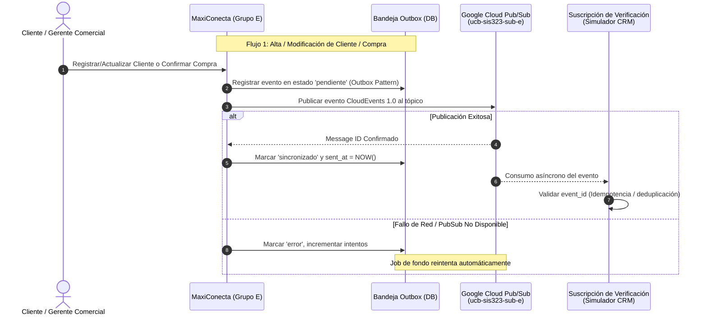

# 14. Contrato de API y Eventos con CRM Corporativo — Google Cloud Pub/Sub (US-40 / KAN-14 / KAN-40 / KAN-171)

**Materia:** UCB SIS-323 — Taller de Sistemas  
**Grupo:** Grupo E — Marketplace y Ventas (*MaxiConecta*)  
**Responsable:** Kevin Sancalli  
**Historia de Usuario Padre:** `KAN-14` / `KAN-40`  
**Requerimiento Funcional:** `RF-40` / `RF-22` / `RF-25` — Integración Asíncrona con CRM Corporativo (Sprint 3)  
**Subtareas:** `KAN-169` (Bandeja outbox, publicador, reintentos y suscripción de verificación), `KAN-171` (Endpoints y Contrato), `KAN-173` (Panel de sincronización con CRM).

---

## 1. Contexto y Objetivos de la Integración Asíncrona

El sistema **MaxiConecta** actúa como canal omnicanal de ventas. Para centralizar la información comercial de los clientes (altas, actualizaciones de perfil, direcciones y compras) en el CRM corporativo sin acoplar los sistemas ni degradar la experiencia de usuario con bloqueos síncronos, se implementa una arquitectura orientada a eventos (*Event-Driven Architecture*) basada en el patrón **Transactional Outbox**, **Google Cloud Pub/Sub** y verificación con idempotencia.



---

## 2. Infraestructura Google Cloud Pub/Sub

- **Proyecto GCP:** `project-a96e5fe1-5ba6-4698-a85`
- **Tópico Asignado:** `projects/project-a96e5fe1-5ba6-4698-a85/topics/ucb-sis323-sub-e`
- **Suscripción de Verificación:** `projects/project-a96e5fe1-5ba6-4698-a85/subscriptions/ucb-sis323-sub-e-crm-verification`
- **Credenciales:** Archivo `service-account.json` (Service Account IAM con roles `roles/pubsub.publisher` y `roles/pubsub.subscriber`).
- **Codificación:** JSON codificado en `UTF-8` bajo el estándar internacional **CloudEvents v1.0**.

---

## 3. Especificación del Envoltorio Estándar (CloudEvents v1.0 Envelope)

Todos los eventos emitidos hacia el CRM corporativo cumplen con el siguiente envoltorio canónico:

```json
{
  "specversion": "1.0",
  "event_id": "evt-crm-a1b2c3d4e5f6",
  "event_type": "cliente.creado",
  "source": "maxiconecta.marketplace.grupo-e",
  "timestamp": "2026-11-03T02:45:00.000Z",
  "correlation_id": "00000000-0000-0000-0000-000000000004",
  "equipo": "Grupo E — Marketplace y Ventas",
  "materia": "UCB SIS-323",
  "payload": {
    "cliente_id": "00000000-0000-0000-0000-000000000004",
    "nombre_completo": "Carlos Perez (Cliente Retail)",
    "email": "cliente@maxiconecta.bo",
    "telefono": "+591 71234567",
    "tipo_cliente": "retail",
    "nit_ci": "7123456",
    "razon_social": "Carlos Perez",
    "puntos_saldo": 120,
    "fecha_registro": "2026-03-01T10:00:00Z"
  }
}
```

### 3.1. Tipos de Eventos Emitidos

| Tipo de Evento | Desencadenador | Descripción |
| :--- | :--- | :--- |
| `cliente.creado` | Registro de nuevo cliente web o creación rápida en POS | Alta de nuevo perfil de cliente con datos de contacto. |
| `cliente.actualizado` | Actualización de perfil o cambio de preferencias | Sincronización de modificaciones en teléfono, nombre o datos de facturación. |
| `cliente.compra_registrada` | Venta cobrada en POS o checkout web confirmado | Notificación de compra para cálculo de scoring y segmentación RFM en CRM. |

---

## 4. Garantías de Entrega y Manejo de Fallos (Outbox Pattern)

### 4.1. Bandeja de Salida Transaccional (`outbox_eventos_crm`)
Cuando se genera un evento para el CRM:
1. Se guarda en la tabla `outbox_eventos_crm` con estado `pendiente` y `event_id` único.
2. Se intenta la publicación hacia el tópico de Google Cloud Pub/Sub.
3. Si la llamada es exitosa, se actualiza el estado a `sincronizado` y se registra `sent_at` y `message_id`.
4. Si la red o Google Cloud fallan, el registro queda en estado `error` y se reintenta automáticamente con retroceso exponencial (*exponential backoff*).

### 4.2. Idempotencia en el Receptor del CRM
Para evitar duplicidad en el CRM por reenvíos de red o reintentos de Pub/Sub:
- El receptor extrae `event_id`.
- Consulta la tabla de recepción de verificación `crm_suscripcion_verificacion`.
- Si el `event_id` ya existe en el histórico de mensajes recibidos, **se descarta silenciosamente** marcándolo como `ignorado_duplicado = TRUE`.
- Si es un `event_id` nuevo, se procesa y se registra.

---

## 5. Endpoints de la API REST de Sincronización (KAN-171)

### 5.1. Consulta de Estado de Sincronización
- **Método:** `GET`
- **Ruta:** `/api/v1/clientes/sync/estado`
- **Respuesta 200 OK:**
```json
{
  "total_clientes": 4,
  "sincronizados": 3,
  "pendientes": 1,
  "errores": 0,
  "topico": "projects/project-a96e5fe1-5ba6-4698-a85/topics/ucb-sis323-sub-e",
  "modo": "ONLINE",
  "clientes": [
    {
      "id": "00000000-0000-0000-0000-000000000004",
      "nombre_completo": "Carlos Perez (Cliente Retail)",
      "email": "cliente@maxiconecta.bo",
      "crm_sync_estado": "sincronizado",
      "crm_sync_at": "2026-11-03T02:40:00Z",
      "crm_contact_id": "CRM-00000000"
    }
  ]
}
```

### 5.2. Re-sincronización Manual de Cliente
- **Método:** `POST`
- **Ruta:** `/api/v1/clientes/{id}/resincronizar`
- **Respuesta 200 OK:**
```json
{
  "cliente_id": "00000000-0000-0000-0000-000000000004",
  "event_id": "evt-crm-b83c21",
  "event_type": "cliente.actualizado",
  "estado": "sincronizado",
  "topico": "projects/project-a96e5fe1-5ba6-4698-a85/topics/ucb-sis323-sub-e",
  "timestamp": "2026-11-03T02:45:10Z",
  "mensaje": "Cliente publicado exitosamente en Google Cloud Pub/Sub y verificado por el simulador de CRM."
}
```
