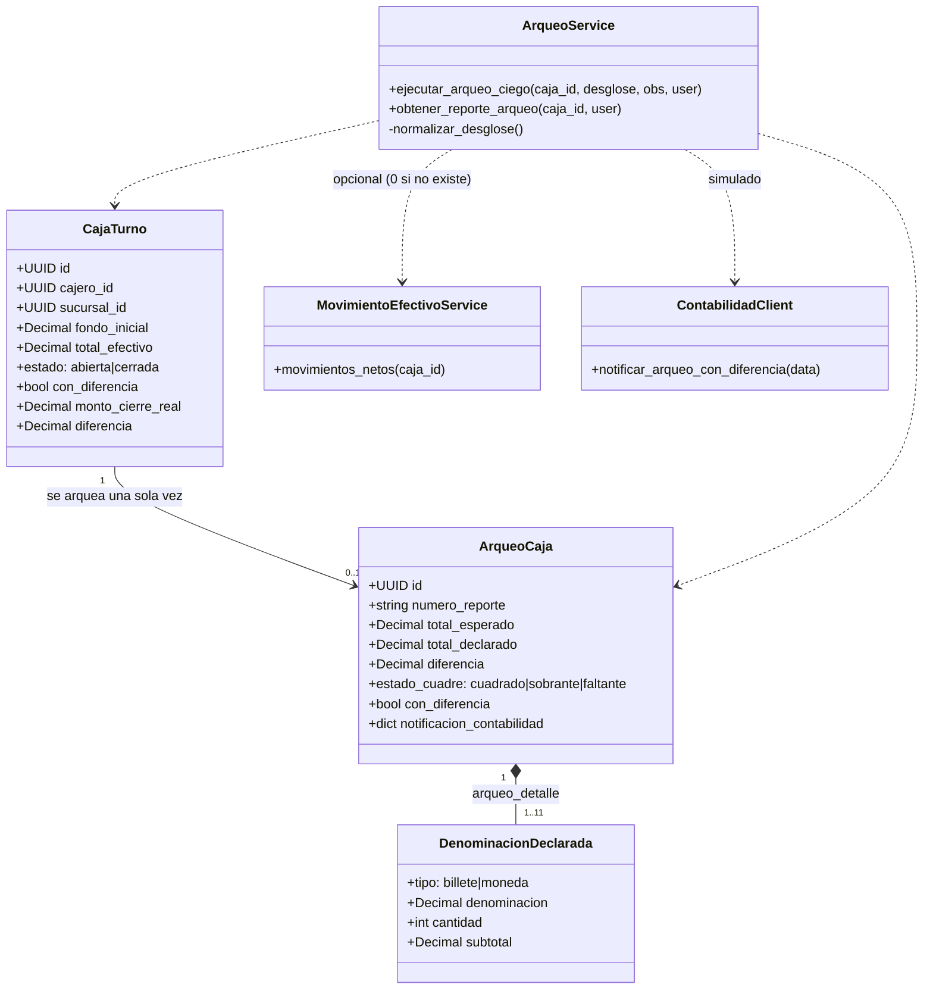
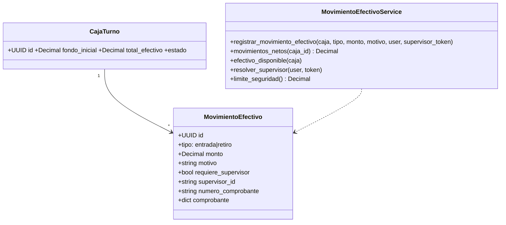
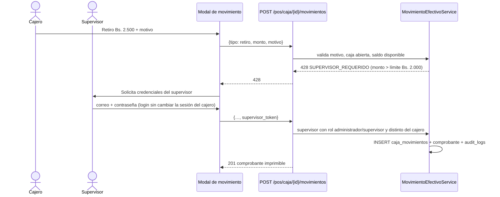
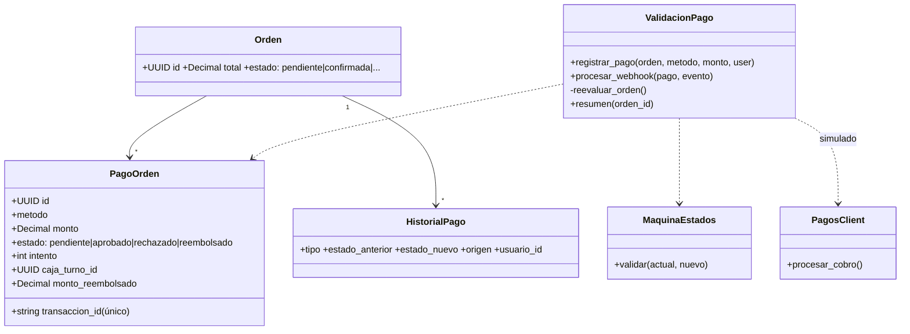
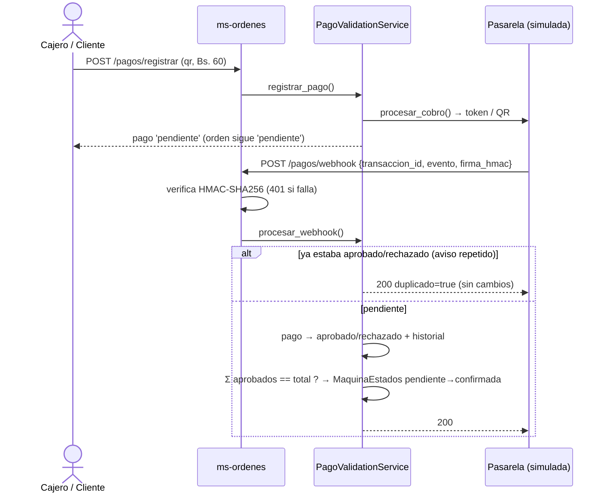
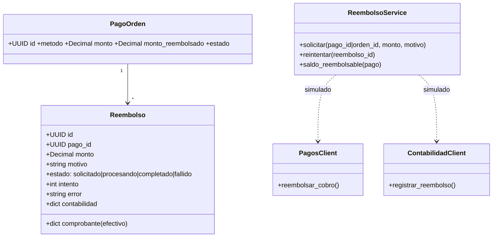
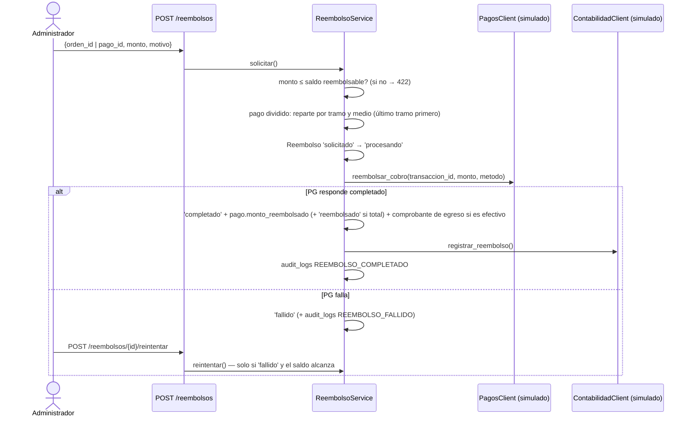

# Diseño Sprint 3 — Arqueo ciego, movimientos de efectivo, validación de pagos y reembolsos

Historias: **KAN-341**, **KAN-342**, **KAN-54**, **KAN-55**. Tareas [DIS] de cada historia (diagramas de clases y de secuencia, Mermaid).
Toda integración con otros sistemas del ERP (Contabilidad, Pagos) es **simulada**: si el ERP no responde, los clientes devuelven una respuesta local (`modo: mock_fallback`).

---

## KAN-341 — Arqueo ciego

### Diagrama de clases


### Secuencia del cierre ciego
```mermaid
sequenceDiagram
    actor C as Cajero
    participant FE as ArqueoCiegoView
    participant API as POST /pos/caja/{id}/arqueo-ciego
    participant S as ArqueoService
    participant DB as caja_turnos / arqueo_caja / arqueo_detalle
    participant CON as ContabilidadClient (simulado)
    C->>FE: Ingresa cantidades por denominación (sin ver totales)
    FE->>API: desglose + observaciones
    API->>S: ejecutar_arqueo_ciego()
    S->>DB: Lee caja; si estado != abierta → 409
    S->>S: esperado = fondo + ventas efectivo + movimientos netos
    S->>S: declarado = Σ denominación × cantidad; diferencia = declarado − esperado
    S->>DB: UPDATE caja_turnos SET estado='cerrada' WHERE estado='abierta' (atómico)
    S->>DB: INSERT arqueo_caja + arqueo_detalle (inmutables) y audit_logs
    alt diferencia ≠ 0
        S->>CON: notificar_arqueo_con_diferencia()
        CON-->>S: recibida (o mock_fallback)
    end
    S-->>API: reporte
    API-->>FE: 201 reporte (recién ahora se revelan los totales)
    FE-->>C: Reporte imprimible de sobrante/faltante
```

---

## KAN-342 — Movimientos de efectivo

### Diagrama de clases


### Secuencia de retiro con confirmación de supervisor


---

## KAN-54 — Validación de pagos de una orden

### Diagrama de clases


### Secuencia de validación por webhook


---

## KAN-55 — Reembolsos

### Diagrama de clases


### Secuencia del reembolso con reintento

